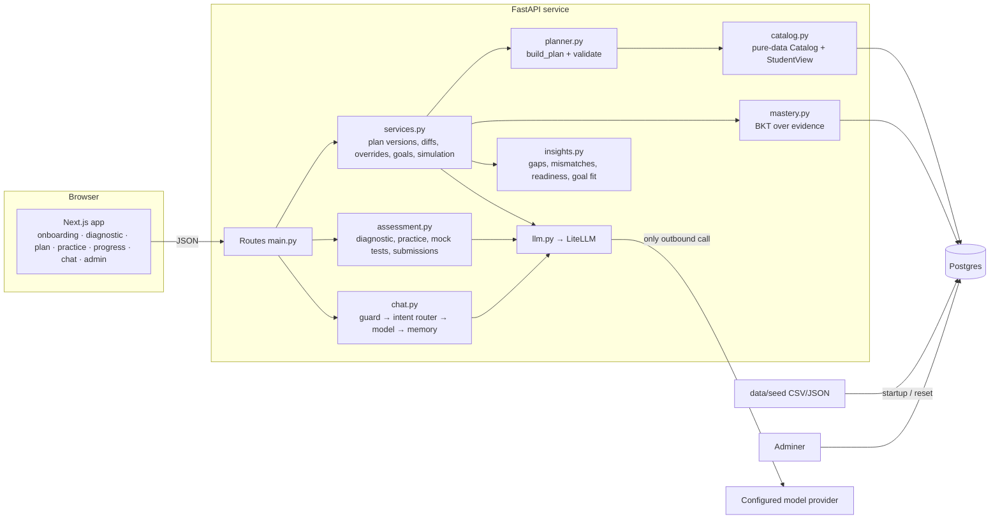

# Technical solution

## Architecture

The four Compose services are `db` (Postgres 16), `api` (Python 3.12, FastAPI, SQLAlchemy, LiteLLM), `web` (Next.js standalone) and `adminer`.

## Learning: how the student profile is represented and updated

- **Profile** (`students`): programme (from which the school code is derived), current semester, CGPA, completed courses with grades, backlogs, interests, constraints (weekly hours outside class, credit headroom, declared open-elective slots, not-together pairs, Minor wish) and preferences (learning style, excluded courses).
- **Evidence** (`evidence`): every signal is a row with a kind, a value from 0 to 1, the number of items, attempts, time spent, topic and source. Kinds and reliability weights live in [`bkt.json`](../data/seed/bkt.json): assessed 0.95, mock test 0.95, grade 0.90 (scaled by how deeply the course covers the skill), quiz 0.85, project 0.85, exercise 0.80, mock interview 0.75, self-declared 0.15, module completion 0.
- **Skill state** comes from Bayesian Knowledge Tracing with soft observations. A score `v` mixes the "correct" and "incorrect" posteriors. Then the learning transition `p_learn` is applied, and the result is blended with the prior by the evidence's reliability. Needing more attempts reduces the effective score.
- Two rules separate completion from proficiency:
  - **Self-declared** evidence is capped below 0.49.
  - A skill with **no tested evidence can't reach mastery** (0.85). Grades only show that a course was completed.
- **Pace** is the median of time spent per question divided by the expected 90 s. A slow pace scales planned hours up by as much as 1.5×.
- **Repeated misses** are counted when tested items score below 0.5, along with their topics.
- **Recompute on every change.** Skill state is rebuilt from the full evidence history (an event-sourced approach). Edits, deletions and seed resets therefore stay consistent.

## Planning: how plans are generated and validated

Everything here is deterministic, implemented in [`planner.py`](../api/app/planner.py) over a pure-data `Catalog` and `StudentView`. The same code serves live plans, what-if simulations and the multi-semester journey.

1. **Remaining semesters:** from the current semester to 8. Odd semesters are Autumn and even ones Spring (Reg. 11.6).
2. **Fixed curriculum:** a B.Tech CSE student's remaining core is placed in its curriculum semester and is never re-planned. Earlier core and first-year courses count as completed unless they are backlogs.
3. **Backlogs first:** each backlog goes into its first offered semester (Reg. 11.6) and blocks additional credits (Reg. 9).
4. **Gaps:** each goal skill below its level target (level 1/2/3 → 0.70/0.80/0.85) is a gap. Gaps are ordered by the goal's required level, then interest, then foundations first along the skill-prerequisite graph. A tested skill within 0.08 of its target gets practice only, not another course.
5. **Courses:** for each gap the planner first checks whether a scheduled core or planned course already covers it. Otherwise it ranks candidate courses by coverage level, how many gaps they close, interest, and whether a slot is available. It then places the course, recursively placing missing prerequisites (choosing within OR groups), at the earliest semester where all of these hold:
   - the season matches the offering;
   - prerequisites are complete before it;
   - there is no not-together conflict;
   - a valid slot exists: an elective slot (CSE: 1/3/2 in semesters 6/7/8; non-CSE: declared open slots), a lateral slot (semesters 4/5/6, another school's lateral), or an additional credit (eligible, within per-semester headroom, within 33% of the major, and within weekly hours, where contact plus self-study hours = extra load).

   A failed placement rolls back any prerequisites it placed.
6. **Remediation:** repeatedly missed skills get review modules, an extra explanation resource and prerequisite-skill refreshers. These are scheduled before anything generic.
7. **Active practice:** one exercise, project or case study per gap, chosen by learning style and level.
8. **Readiness work:** projects, the timed mock test and mock interviews, as each goal's readiness criteria require.
9. **Open resources** fill whatever weekly time is left, chosen by level and preferred format. Soft caps per semester spread the work out.
10. **Milestones** beyond coursework (internships, GRE/GATE/CAT/UPSC timelines, incubation cell) come from the goal template.
11. **Skipped modules:** modules whose skill is already demonstrated, and intro modules the student has shown they know, are listed as skipped, never assigned.
12. **Honest infeasibility:** when time, slots or eligibility make something impossible, the plan says so in one note and gives the best valid option (for example "raise weekly hours to about 13, or narrow the goal", or "Minor needs CGPA 7.50; use laterals and open resources now").

`validate()` re-checks every rule independently of the builder: known codes, completed or excluded or duplicate courses, offering season, AND-of-OR prerequisites, slot legality and capacity, headroom, the 33% cap, weekly hours (including resources and practice), not-together pairs, mastered content, backlog placement and NPTEL credit. `create_plan` refuses to save a plan that has any violation.

**Versioning:** each re-plan stores a new `plans` row with its trigger, a parent version, a diff (courses added, removed and moved; resources, practice and review changes) and a change explanation. A plan identical to the previous one is not re-saved.

## Solving: how each conversation request is handled

[`chat.py`](../api/app/chat.py) handles each message in this order:

1. **Guard.** Prompt-injection and record-editing patterns ("ignore previous instructions", "set my CGPA") get a fixed refusal. Chat can never change records except through explicit, validated commands (reject or allow a course, change goal).
2. **Deterministic intents**, answered from the database. The model is not called:
   - why a course is or isn't in the plan, with the actual reason (slot, gap, prerequisite, mastered, excluded, not offered);
   - reject or allow a course, including the trade-offs and the refusal for backlogs;
   - change goal, with a clarifying question if the goal is vague;
   - what-if strong or weak quiz;
   - readiness, next steps, what changed, strengths and gaps, eligibility;
   - off-topic refusal.
3. **Open questions** go to the model with a system prompt, a **pinned context** block, the latest summary memory and the last 8 turns of this session. The pinned context holds goal, constraints, exclusions, eligibility, the first 3 semesters of the plan, top gaps, recent evidence, long-term memory and readiness. Student text is wrapped as data. An answer that mentions a course code outside the catalog is discarded and the deterministic answer is used instead.
4. **Return to the plan:** every answer ends with "Back to your plan: <next step>".
5. **Memory:** every turn is stored in `messages`. When a session passes 16 messages, older turns are summarised into `memory(kind=summary)`. Overrides, goal changes and onboarding facts are stored as memory and are always in the pinned context. "Welcome back" reports plan versions created since the last session, so the student never has to repeat themselves.

## Mastery evaluation

| Level | How it's shown |
|---|---|
| Skill demonstrated | estimate ≥ 0.85 **with tested evidence** (diagnostic, quiz, mock test, graded exercise/project, mock interview) |
| Skill meets goal | estimate ≥ the level target for that goal |
| Course completed | a grade exists; shown separately as "completed - proficiency not yet demonstrated" until tests confirm it |
| Goal readiness | per goal in `goals.json`: share of goal skills at target, timed mock test score (only tests within the time limit count; the server times them), N projects passing the rubric, N mock interviews ≥ 60% |

MCQ grading is exact-match against an answer key. Model-generated questions are only kept if they have four distinct options and one keyed answer. Rubric grading needs a model; without one, submissions wait for a mentor's grade, so completion is never credited as proficiency.

## Engineering notes

- **Robustness:** calls are retried twice with backoff on timeouts, rate limits and connection errors. Every model feature has a deterministic fallback, so a model outage never blocks planning (see `tests/test_llm_path.py`).
- **Consistency:** temperature 0, a response cache keyed by a hash of (model, messages, purpose), and a deterministic planner. The evaluation checks that re-planning produces an identical plan.
- **Cost and latency:** only open questions, explanations, goal parsing, grading and generation call the model, with capped context sizes. Bulk admin re-processing skips the model. `llm_calls` logs tokens and latency per purpose (`/admin/llm-usage`).
- **Scalability:** planning is pure and per-student, about 10 ms on the 61-course catalog. The API is stateless apart from Postgres. Model bookkeeping is buffered and flushed after each request.
- **Safety:** no secrets in images, CORS limited to localhost, and every input validated by Pydantic plus referential checks.
